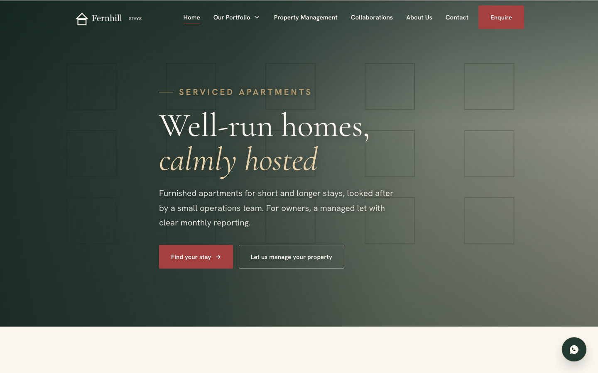
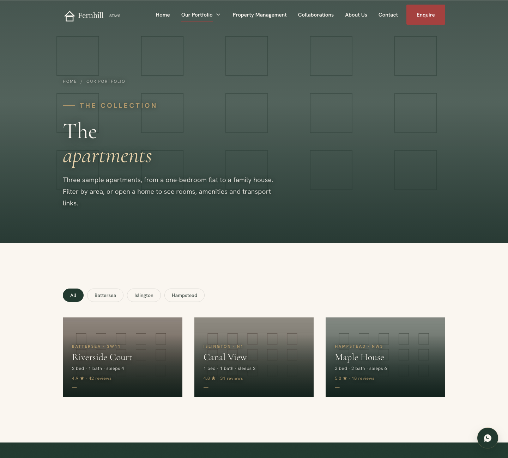
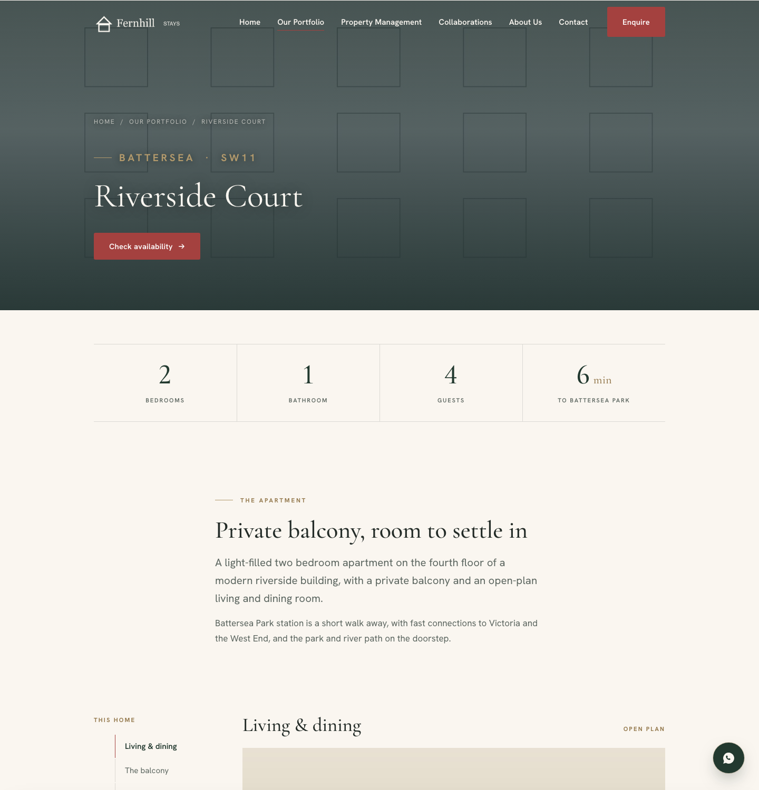
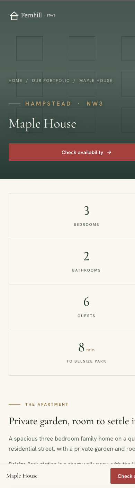

# Business Website

A responsive, multi-page marketing website for a serviced-apartment and property-management business. Plain HTML, CSS and JavaScript with no framework and no build step.

This repository is a **sanitised portfolio version** of a site I delivered for a real small business. The production site is live and maintained privately. Here, the client's name, branding, contact details, property listings, photography, reviews and company information have all been replaced with a fictional brand (*Fernhill Stays*), three fictional apartments and generated placeholder images. The structure, styling, scripts and interaction design are the same as production.

**Live demo (fictional content):** <https://dadocode.github.io/business-website/>



## What the site does

- **Eleven pages:** home, portfolio index with area filters, three property pages, property-management service page, about, collaborations, contact, privacy and a custom 404.
- **Enquiry flow:** a slide-in enquiry drawer on every property page, pre-filled with the property name, plus a full contact form with client-side validation. Submissions post to [Web3Forms](https://web3forms.com); with no key configured, the form falls back to a pre-filled `mailto:` link.
- **Property pages:** room-by-room sections with a sticky in-page index, amenity groups, transport and "nearby" lists, and a sticky mobile booking bar.
- **Progressive enhancement:** every page is readable and navigable without JavaScript. Scripts add the scroll-aware header, mobile menu, dropdown navigation, filters, carousel, reveal animations and form handling.
- **Accessibility:** skip link, landmark structure, ARIA labelling on interactive controls, keyboard support for menus, drawer and carousel, and `prefers-reduced-motion` respected throughout.
- **SEO:** per-page titles, descriptions and Open Graph tags, JSON-LD structured data (`LocalBusiness`, `Accommodation`, `BreadcrumbList`), `sitemap.xml` and `robots.txt`.

| Portfolio index | Property page | Mobile |
|---|---|---|
|  |  |  |

## Technical approach

- **No dependencies.** About 1,000 lines of CSS and 600 lines of JavaScript across two files (`js/main.js` for behaviour, `js/motion.js` for animation).
- **Design tokens.** One `:root` block defines colour, type and spacing; layouts use fluid `clamp()` values rather than many breakpoints.
- **Static hosting.** `netlify.toml` sets cache headers and security headers. The site also runs on Cloudflare Pages, Vercel or GitHub Pages without changes.

```
├── index.html, homes.html, home-*.html     Home, index and property pages
├── property-management.html, about.html, collaborations.html, contact.html, privacy.html, 404.html
├── css/styles.css                          Design tokens and all styling
├── js/main.js                              Navigation, filters, carousel, drawer, forms
├── js/motion.js                            Scroll reveals and reduced-motion handling
├── assets/                                 Placeholder images, logo, favicons
├── serve.py                                Local server with clean URLs
└── netlify.toml, sitemap.xml, robots.txt
```

## Running locally

```bash
git clone https://github.com/DadoCode/business-website.git
cd business-website
python3 serve.py
```

Then open <http://localhost:8000>. `serve.py` maps clean URLs such as `/homes` to `homes.html`, as the static hosts do.

To connect the enquiry form, set `SITE_FORM_ACCESS_KEY` near the top of `js/main.js` (see `.env.example`). Do not commit a real key.

## My role

I owned the project end to end for the client: brief and information architecture, content and imagery, design direction, accessibility and performance review, cross-device testing, form integration, deployment and ongoing updates.

The code was written with an AI coding assistant (Claude) under my direction. I set the architecture (static HTML over a CMS or framework, so a non-developer can maintain it; progressive enhancement; a token-based stylesheet), reviewed and corrected the output, and sent work back for rework on layout, motion and accessibility until it met the brief.

## Licence

Code is released under the MIT licence. See [LICENSE](LICENSE).
